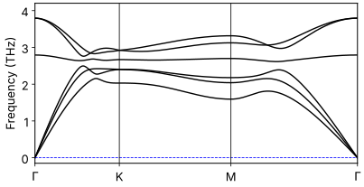
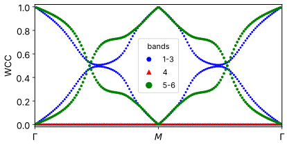
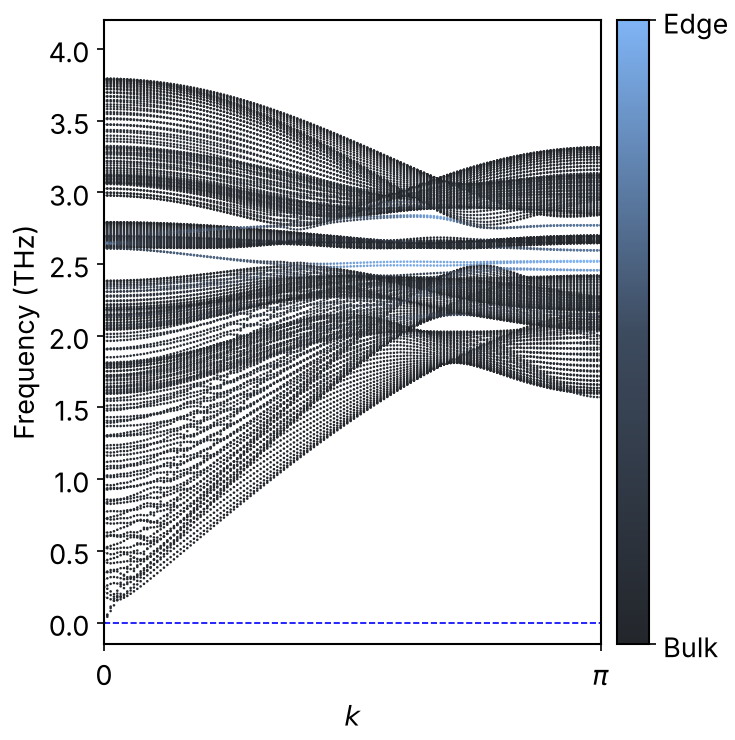
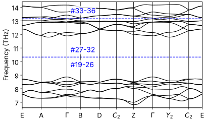
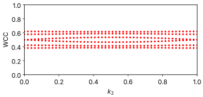
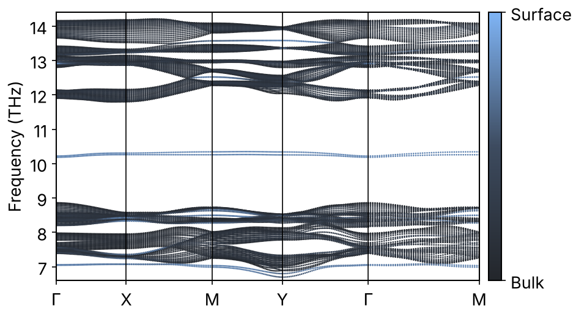
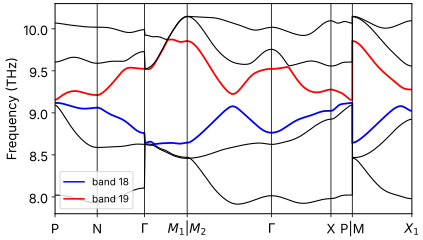
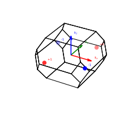
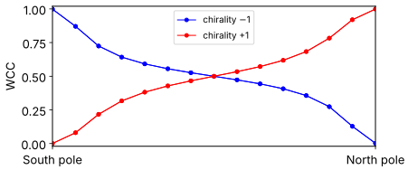
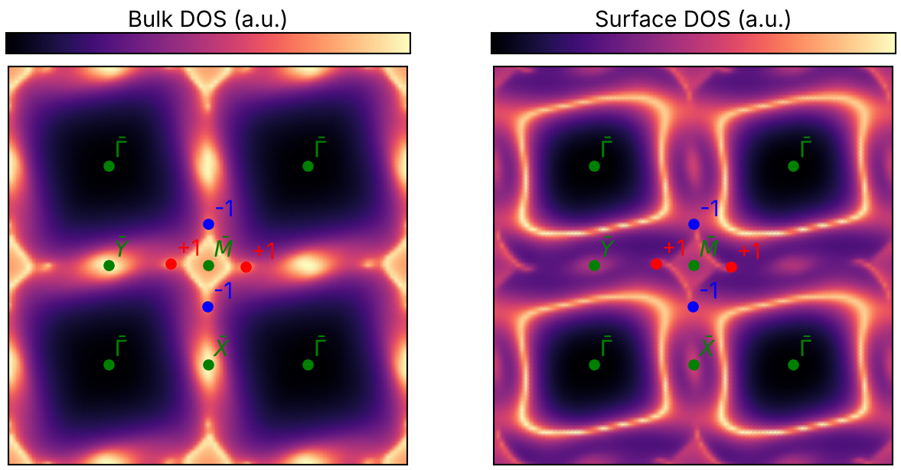

<a name="readme-top"></a>

<div align="center">


<h1 align="center">Welcome to Simphony!</h1>
 <h3 align="center"><ins>SIM</ins>ulated <ins>PHON</ins>on topolog<ins>Y</ins></h3>

Simphony is an open-source software package designed for the topological analysis of lattice vibrations based on Wannier tight-binding models, mainly built from WannierTools. Its primary function is to classify the topology of novel materials by computing bulk and slab phonon band structures, extracting phonon surface spectra, and providing analysis tools such as Wilson loop calculations and Weyl node detection. It also incorporates the long-range dipole–dipole interactions of polar materials, which makes it possible to diagnose the topology of polar insulators.

Simphony is described in [F. Ballester *et al.*, Comput. Phys. Commun. **329**, 110373 (2026)](https://doi.org/10.1016/j.cpc.2026.110373). If you use it in your work, please <a href="#citation">cite it</a>.

</div>

<!-- Index -->
<details>
  <summary>Table of Contents</summary>
  <ol>
    <li><a href="#installation">Installation</a></li>
    <li>
      <a href="#how-to-use-simphony">How to use Simphony</a>
      <ul>
        <li><a href="#generating-the-input-files">Generating the input files</a></li>
        <li><a href="#the-pnin-file">The pn.in file</a></li>
        <li><a href="#polar-materials-lo-to-splitting">Polar materials: LO-TO splitting</a></li>
        <li><a href="#slabs-ribbons-and-reciprocal-space-cards">Slabs, ribbons and reciprocal-space cards</a></li>
        <li><a href="#running-simphony">Running Simphony</a></li>
      </ul>
    </li>
    <li>
      <a href="#examples">Examples</a>
      <ul>
        <li><a href="#buckled-honeycomb-lattice">Buckled honeycomb lattice</a></li>
        <li><a href="#obstructed-atomic-limit-in-agp2">Obstructed atomic limit in AgP<sub>2</sub></a></li>
        <li><a href="#weyl-nodes-in-al2znte4">Weyl nodes in Al<sub>2</sub>ZnTe<sub>4</sub></a></li>
      </ul>
    </li>
    <li><a href="#citation">Citation</a></li>
    <li><a href="#acknowledgements">Acknowledgements</a></li>
    <li><a href="#roadmap">Roadmap</a></li>
  </ol>
</details>


## Installation

### Prerequisites

To install Simphony you need the following basic requirements:
<ol>
    <li> A Unix-based operating system </li>
    <li> A Fortran 90 compiler: gfortran or ifort </li>
    <li> LAPACK and BLAS libraries </li>
    <li> OPTIONAL: an MPI-enabled Fortran 90 compiler for parallel execution </li>
</ol>

The helper scripts in *simphony/utility_scripts* (see <a href="#generating-the-input-files">Generating the input files</a>) also need Python 3 with numpy, seekpath, [CellConstructor](https://github.com/SSCHAcode/CellConstructor) and [python-sscha](https://github.com/SSCHAcode/python-sscha) (which provides the `symph` module), plus [phonopy](https://phonopy.github.io/phonopy/) and PyYAML for the phonopy route.

### Compilation

To compile Simphony, clone the repository wherever you want your installation to be, using:
```
> git clone https://github.com/fballestermacia/simphony.git
```
or download the zip file directly from the [GitHub repository](https://github.com/fballestermacia/simphony).

The code can be compiled using the standard Makefile located in the *simphony/src* directory, which is compatible with most architectures. Additional template Makefiles are provided for specific architectures (*Makefile.gfortran-mpi*, *Makefile.intel-seq*, *Makefile.intel-mpi*, ...), and users may modify them as needed. To compile the code, run the following command from the *simphony/src* directory:

```
> make
```

or, for the parallel version with gfortran and MPI,

```
> make clean
> make -f Makefile.gfortran-mpi
```

Then, inside the *simphony/bin* directory, an executable file named *pn.x* should appear.

It is recommended to add the *simphony/bin* folder to your PATH by including the following line

```
export PATH=PATHTOYOURSimphonyINSTALLATION/simphony/bin:$PATH
```
in your *.bashrc* file in your home directory. The *bin* folder also contains links to the helper scripts *QE2TBDAT*, *PHONOPY2TBDAT* and *createSimphonyInput*.

With that, the code is ready to go! Check the <a href="#how-to-use-simphony">How to use Simphony</a> section for more details on running the program.


## How to use Simphony
Running Simphony requires only two input files: a *wannier90_hr.dat* file (named *prefix_phononTB_hr.dat* by the helper scripts), which contains all the information about the short-range dynamical matrix needed to build the tight-binding model (following the format described in [Wannier90](https://wannier90.readthedocs.io)), and a *pn.in* file, which provides system details, instructions, and simulation parameters.

The *wannier90_hr.dat* file contains the hopping parameters of the TB model (i.e., the dynamical matrix $D_{\kappa\alpha,\kappa'\beta}(\mathbf{R})$ in real space, in THz<sup>2</sup>), with the long-range dipole-dipole interaction subtracted for polar materials. Simphony adds the long-range part back analytically at every $\mathbf{q}$ (see <a href="#polar-materials-lo-to-splitting">Polar materials</a>).

### Generating the input files

**From QuantumESPRESSO.** The Python script *QE2TBDAT*, found in the *simphony/utility_scripts* directory, reads the output of a QuantumESPRESSO *ph.x* run (the *name.dyn1*, *name.dyn2*, ... files) using the SSCHA [CellConstructor](https://github.com/SSCHAcode/CellConstructor) package, and generates the corresponding *name_phononTB_hr.dat* file. The script automatically subtracts the long-range part of the dynamical matrix (if present) from the output of QuantumESPRESSO, which ensures compatibility with the Ewald summation used by Simphony, and imposes the acoustic sum rule. Another script, *createSimphonyInput*, generates a default *pn.in* file from the same output:

```
> QE2TBDAT PathTo/name.dyn N_irr_q
> createSimphonyInput PathTo/name.dyn N_irr_q
```

where *N_irr_q* is the number of irreducible $q$-points of the *ph.x* calculation.

**From phonopy (e.g. VASP + phonopy).** The script *PHONOPY2TBDAT* does the same from a phonopy calculation:

```
> PHONOPY2TBDAT phonopy.yaml [FILE ...] [-p PREFIX] [--no-nac]
> createSimphonyInput phonopy.yaml [BORN|-] [PREFIX]
```

The optional *FILE*s are any of *FORCE_CONSTANTS* (or *force_constants.hdf5*), *FORCE_SETS* and *BORN*, in any order (each file is recognised by its content). If no force-constant file is given, *FORCE_SETS* next to *phonopy.yaml* (or the forces stored in the yaml) is used. Born effective charges and the dielectric tensor are taken from the *BORN* file if given; otherwise phonopy's defaults are used (the values stored in the yaml, as in *phonopy_params.yaml* files, or a *BORN* file in the current directory), and `--no-nac` ignores them. *PHONOPY2TBDAT* writes *PREFIX_phononTB_hr.dat* (default *PREFIX*: the yaml file name without extension) and *PREFIX_pn_cards.in* with the *LATTICE*, *ATOMS*, *LOTO_DT* and *LOTO_BC* cards. Use the same *PREFIX* in both scripts. Current restrictions: diagonal supercell matrices only, and the phonopy unit cell must be the primitive cell.

The cards in the *pn.in* file are routine-dependent, and general default values for these cards are generated by the *createSimphonyInput* script.

### The pn.in file

The *pn.in* file is structured in namelists and cards. The main namelists of Simphony are:
<ul>
    <li> <i>&TB_FILE</i> : Indicates the name of the <i>wannier90_hr.dat</i> file (<i>Hrfile</i>).</li>
    <li><i>&CONTROL</i> : Lets Simphony know which subroutines to run.</li>
    <li><i>&SYSTEM</i> : Includes parameters when building the system, such as the number of layers in the slab or the number of bands to include in the WCC calculation.</li>
   <li><i>&PARAMETERS</i> : Parameters of the simulation, such as the number of points in the grid in reciprocal space or energy range on which to compute the spectral function.</li>
</ul>

The complete list of available routines included in Simphony is:
<ul>
    <li><i>LOTO_correction</i>: whether to include LO-TO splitting.</li>
    <li><i>BulkBand_calc</i>: calculate the bulk band structure along a high-symmetry path.</li>
    <li><i>BulkBand_plane_calc</i>: calculate the bulk band structure in a plane.</li>
    <li><i>BulkGap_cube_calc</i>: calculate the energy gap between two bands on a 3D grid of q-points.</li>
    <li><i>BulkGap_plane_calc</i>: calculate the energy gap between two bands in a plane. </li>
    <li><i>SlabBand_calc</i>: construct a slab Hamiltonian and compute its band structure along a path.</li>
    <li><i>SlabSS_calc</i>: compute the surface spectral function along a path within an energy window.</li>
    <li><i>SlabArc_calc</i>: compute the surface spectral function on a constant-energy isosurface.</li>
    <li><i>WireBand_calc</i>: construct a ribbon Hamiltonian and compute the band structure from $-\pi$ to $\pi$.</li>
    <li><i>Dos_calc</i>: compute the density of states (DOS) within an energy window.</li>
    <li><i>FindNodes_calc</i>: locate gapless points between two bands.</li>
    <li><i>BerryPhase_calc</i>: compute the Berry phase along a closed loop in the 3D Brillouin zone.</li>
    <li><i>BerryCurvature_calc</i>: compute the Berry curvature in a 2D plane.</li>
    <li><i>Chern_3D_calc</i>: compute the Wannier charge centers (WCCs) along the planes $k_1=0$, $k_1=0.5$, $k_2=0$, $k_2=0.5$, $k_3=0$ and $k_3=0.5$.</li>
    <li><i>Wanniercenter_calc</i>: compute WCCs in a specified plane.</li>
    <li><i>WeylChirality_calc</i>: compute WCCs on a sphere centered at a given point to determine Weyl node chirality.</li>
</ul>

In addition, setting *apply_ASR = T* in *&CONTROL* imposes the acoustic sum rule (ASR) on the slab and ribbon Hamiltonians, which can be broken by the construction used in *SlabBand_calc* and *WireBand_calc*.

All frequencies (*OmegaMin*, *OmegaMax*, *E_arc*, *Gap_threshold*, ...) are given in THz. Some cards are required for most subroutines, such as *LATTICE*, *ATOMS*, and *KPATH_BULK*.

The *LATTICE* card is structured as follows
```
LATTICE
Angstrom or Bohr
a1
a2
a3
```

The *ATOMS* card has the following format:
```
ATOMS
Number of Atoms
Direct or Cartesian
Symbol mass (in a.u.) position
Symbol mass (in a.u.) position
...
```

And the *KPATH_BULK* card is:
```
KPATH_BULK
Number of segments
Start_label1 coordinates (direct) End_label1 coordinates (direct)
Start_label2 coordinates (direct) End_label2 coordinates (direct)
Start_label3 coordinates (direct) End_label3 coordinates (direct)
...
```

Examples of various input files can be found in the *simphony/examples* directory.

### Polar materials: LO-TO splitting

In polar insulators the dynamical matrix is split into a short-range and a long-range part, $D = D^{SR} + D^{LR}$. Only $D^{SR}$ is stored in the *wannier90_hr.dat* file; the dipole-dipole term $D^{LR}$ (Gonze-Lee, computed with an Ewald sum) is added back at each $\mathbf{q}$ when

```
&CONTROL
LOTO_correction = T
/
```

This requires two additional cards: the high-frequency dielectric tensor $\varepsilon^\infty$ (dimensionless, 3×3),

```
LOTO_DT
eps_xx eps_xy eps_xz
eps_yx eps_yy eps_yz
eps_zx eps_zy eps_zz
```

and the Born effective charges $Z^*$ (in units of $e$), three rows per atom in the same order as the *ATOMS* card, where the row index is the electric-field direction and the column index the displacement direction:

```
LOTO_BC
Z*(1)_xx Z*(1)_xy Z*(1)_xz
Z*(1)_yx Z*(1)_yy Z*(1)_yz
Z*(1)_zx Z*(1)_zy Z*(1)_zz
Z*(2)_xx ...
...
```

The acoustic sum rule is imposed on the Born charges when they are read. Both cards are written automatically by *createSimphonyInput* (and *PHONOPY2TBDAT*). For slabs and ribbons, $D^{LR}$ is Fourier transformed to real space from a $\mathbf{q}$-grid set by the optional card

```
LOTO_INTERPOLATE
11 11 11
```

(11×11×11 by default). The long-range term assumes 3D screening; the 2D long-range interaction of isolated layers is not treated.

### Slabs, ribbons and reciprocal-space cards

Slab and ribbon calculations need the surface on which to cut the crystal. It is given either by the *SURFACE* card, with the two lattice vectors that span the surface written as integer combinations of $\mathbf{a}_1$, $\mathbf{a}_2$, $\mathbf{a}_3$,

```
SURFACE
1 0 0     ! a1' = 1*a1 + 0*a2 + 0*a3
0 1 0     ! a2' = 0*a1 + 1*a2 + 0*a3
```

or by its Miller indices,

```
MILLER_INDEX
1 0 0
```

If both are present, the *SURFACE* card is used; if neither is, the (001) surface is used. The third lattice vector of the slab is chosen automatically. The number of unit cells in the slab is set with *NSLAB* (and *NSLAB1*, *NSLAB2* for ribbons) in *&SYSTEM*, and the number of principal layers of the surface Green's function with *NP* in *&PARAMETERS*.

Other cards used by the different routines are:
<ul>
    <li><i>KPATH_SLAB</i>: path in the 2D surface Brillouin zone (same format as <i>KPATH_BULK</i>, with two coordinates per point, in units of the surface reciprocal vectors).</li>
    <li><i>KPLANE_BULK</i> / <i>KPLANE_SLAB</i>: origin and two vectors that define a plane in the 3D (direct coordinates) or 2D Brillouin zone.</li>
    <li><i>KCUBE_BULK</i>: origin and three vectors that define a 3D region of the Brillouin zone.</li>
    <li><i>SELECTED_OCCUPIED_BANDS</i>: set of bands used in the WCC calculations (e.g. <code>27-32</code>). If absent, bands 1 to <i>NumOccupied</i> are used.</li>
    <li><i>WEYL_CHIRALITY</i>: points around which <i>WeylChirality_calc</i> computes the chirality (see the <a href="#weyl-nodes-in-al2znte4">Al<sub>2</sub>ZnTe<sub>4</sub> example</a>).</li>
</ul>

### Running Simphony

Inside a folder containing both input files, the Simphony executable
can be run as follows:
```
pn.x
```
or in multiprocessor mode
```
mpirun -np 4 pn.x
```

Afterward, Simphony will generate several output files in the current directory. The main output file, *PN.out*, contains information about the run and how Simphony interpreted the input files. Additionally, depending on the calculations performed, other files will be produced, primarily *.dat* and *.gnu* files. The former contains the numerical data resulting from the calculations, conveniently structured for plotting, while the latter consists of scripts used by gnuplot to quickly visualize the *.dat* files. The main output files are:

| Routine | Output |
| --- | --- |
| BulkBand_calc | *bulkek.dat* |
| SlabBand_calc | *slabek.dat* (with the weights on the bottom and top surfaces) |
| WireBand_calc | *ribbonek.dat* |
| SlabSS_calc | *dos.dat_l*, *dos.dat_r*, *dos.dat_bulk* |
| SlabArc_calc | *arc.dat_l*, *arc.dat_r*, *arc.dat_bulk* |
| Wanniercenter_calc | *wcc.dat* |
| FindNodes_calc | *Nodes.dat* |
| WeylChirality_calc | *wanniercenter3D_Weyl.dat* (chiralities are also printed in *PN.out*) |


## Examples

To illustrate the usage of Simphony, we present a simple Buckled Honeycomb Lattice model along with two real materials, using example input files for the calculation of their topological properties. All necessary files can be found in the *simphony/examples* directory, and the inputs shown below are the ones used in the [Simphony article](https://doi.org/10.1016/j.cpc.2026.110373). The figures in this section were obtained by running these example inputs with the current version of the code.

### Buckled honeycomb lattice

The buckled honeycomb lattice (BHL) model can present non-trivial sets of bands when considering third-nearest neighbor couplings. To showcase the usage of Simphony we use the simple BHL model of [M. Gutierrez-Amigo *et al.*, Phys. Rev. B **107**, 144307 (2023)](https://doi.org/10.1103/PhysRevB.107.144307) with couplings up to third nearest neighbors. Depending on the specific values of the couplings, the model can describe 11 distinct topological phases. In this example, we have tuned the couplings to reproduce phase 2, which is topologically nontrivial.

We compute the bulk dispersion, Wannier charge center and ribbon dispersion in one single run of Simphony. To do so, we set the *&CONTROL* namelist with the following variables set to true:

```
&CONTROL
BulkBand_calc         = T
Wanniercenter_calc    = T
WireBand_calc         = T
apply_ASR             = T
/
```

This tells Simphony which calculations to perform, but the program still requires the specific parameters for the simulation. An example of such an input file can be found in the *simphony/examples/BHL* directory. The following calculation-specific parameters must also be included in the input file:

```
&SYSTEM
NSLAB1 = 40
NSLAB2 = 1
NumOccupied = 3
/

&PARAMETERS
Nk1 = 150
Nk2 = 150
/

KPLANE_BULK
0.00 0.00 0.00   ! Original point for 3D k plane
1.00 0.00 0.00   ! The first vector to define 3d k space plane
0.00 1.00 0.00   ! The second vector to define 3d k space plane

MILLER_INDEX
1 0 0

SELECTED_OCCUPIED_BANDS
1-3
```

For the calculation of the bulk band structure, the only required parameter is the number of points per segment, specified by the *Nk1* variable. The Wannier center subroutine requires a grid of points in a plane of reciprocal space, defined by *Nk1* and *Nk2*. The *NumOccupied* variable specifies the number of occupied bands to be considered, from the first up to the *NumOccupied*-th band, for the WCC calculation; alternatively, the *SELECTED_OCCUPIED_BANDS* card can also be set. This subroutine also needs a plane on which to define the grid, provided via the *KPLANE_BULK* card.

For the ribbon band structure, *Nk1* defines the number of points along the 1D Brillouin zone, and a surface must be specified using the *MILLER_INDEX* card. To construct the ribbon geometry, the unit cell is repeated *NSLAB1* times along the non-periodic direction and *NSLAB2* times along the periodic direction.

In case some parameters are missing from the input file, Simphony uses some default values that might not be appropriate for all calculations. All details regarding the parameters used are found in the *PN.out* output file.

The bulk phonon band structure displays three distinct sets of bands:



By performing the Wannier charge center calculation for each isolated band set (changing *SELECTED_OCCUPIED_BANDS* to `1-3`, `4` and `5-6`), we obtain



which reveals a winding number of 1 for the top two bands, whereas on the first four bands no winding is present, as discussed in the reference above. This topological invariant indicates the presence of protected edge states, which are clearly visible in the band structure of a ribbon of 40 unit cells (the color represents the projection onto the edges of the ribbon):



Note that the slab and ribbon Hamiltonians used by *WireBand_calc* and *SlabBand_calc* can break the ASR, which can be solved by imposing the ASR directly by setting *apply_ASR = T* in the *&CONTROL* namelist.

### Obstructed atomic limit in AgP<sub>2</sub>

AgP<sub>2</sub> is an insulator belonging to space group $P2_1/c$ (No. 14), thus, in the *&CONTROL* namelist we must include:

```
LOTO_correction       = T
```
for all calculations.

For this example, we will calculate the bulk bands of the system, the WCC of an obstructed atomic band representation (OABR), and the band structure of the slab. Thus, our full *&CONTROL* namelist will be:

```
&CONTROL
LOTO_correction       = T
BulkBand_calc         = T
Wanniercenter_calc    = T
SlabBand_calc         = T
apply_ASR             = T
/
```

All calculations can be done on the same run or separately.

For the *BulkBand_calc* and the *SlabBand_calc* tags we need to set the *Nk1* tag in the *&PARAMETERS* namelist. The *wannier90_hr.dat* file of this example was created with the *QE2TBDAT* script from a QuantumESPRESSO calculation on a 4×4×4 grid of $q$-points, using a PBE functional and an 8×8×8 grid of $k$-points for the SCF calculation. The resulting bulk band structure (the article compares it with the *ab initio* one, showing clear agreement) is



where the three highest sets of bands and their band indices are indicated.

We also need *Nk2* for the WCC calculation, so we must include both in the *&PARAMETERS* namelist

```
&PARAMETERS
Nk1 = 50
Nk2 = 50
/
```

For the *&SYSTEM* namelist, the width of the slab to be computed must be set using the *NSLAB* parameter. For the WCC calculation, the *NumOccupied* parameter should be set to the index of the highest band to be considered occupied. Thus:

```
&SYSTEM
NSLAB = 10
NumOccupied = 32
/
```

However, this will consider the subspace spanned from the first band to the 32nd band, and since this subspace includes several independent sets of bands, it is often more convenient to consider isolated sets of bands for the WCC calculation. In this case, the relevant set corresponds to bands 27 through 32, which can be selected using the *SELECTED_OCCUPIED_BANDS* card as follows:

```
SELECTED_OCCUPIED_BANDS
27-32
```

The WCC of these bands on the $k_z=0$ plane (*KPLANE_BULK* card of the example) are



According to these results, this set of bands corresponds to an OABR, as discussed in [Y. Xu *et al.*, Science **384**, eadf8458 (2024)](https://doi.org/10.1126/science.adf8458), which, due to the bulk-edge correspondence, leads to a surface state. Thus, we select the (001) surface for our slab calculations by including the following card:

```
SURFACE
1 0 0
0 1 0
```

which selects the surface defined by vectors $\mathbf{a}_1$ and $\mathbf{a}_2$. Then, *SlabBand_calc* gives the slab band structure along the *KPATH_SLAB* path, which shows a clear surface state between the two sets of bands, around 10.3 THz. For clarity we only show the projection onto one surface, but Simphony computes the projection onto both surfaces of the slab (columns 3 and 4 of *slabek.dat*):



### Weyl nodes in Al<sub>2</sub>ZnTe<sub>4</sub>

In the final example, we study the Weyl nodes between the 18th and 19th bands of Al<sub>2</sub>ZnTe<sub>4</sub>, a compound belonging to space group $I\bar{4}$ (No. 82). As this compound is an insulator, the LO-TO correction must be taken into account. The phonon bands around the nodes are shown below, with the 18th (19th) band in blue (red). Since the system is not cubic, discontinuities appear at $\Gamma$ due to LO-TO splitting.



We begin by showcasing the *FindNodes_calc* subroutine, which locates gapless points using Nelder and Mead's downhill simplex method. To do so, we need to define a sufficiently dense $q$-point mesh (typically, 15 points in each direction are sufficient) by setting the *Nk1*, *Nk2*, and *Nk3* parameters accordingly. Additionally, a threshold for identifying gapless points can be specified using the *Gap_threshold* tag in the *&PARAMETERS* namelist. For example:

```
&CONTROL
LOTO_correction       = T
FindNodes_calc        = T
/

&SYSTEM
NumOccupied = 18
/

&PARAMETERS
Nk1 = 15
Nk2 = 15
Nk3 = 15
Gap_threshold = 0.000001   ! in THz
/
```

The *NumOccupied* tag tells Simphony to look between the *NumOccupied*-th and (*NumOccupied*+1)-th bands for points with a gap smaller than *Gap_threshold* in a grid of *Nk1* x *Nk2* x *Nk3* points.

For simplicity, as done in the reference above, we will consider only the Weyl nodes located at the $k_z = 0$ plane. The *FindNodes_calc* routine writes the location of the gapless points in a file named *Nodes.dat*. The location of these four points in the first Brillouin zone, together with their chirality (computed below), is:



Then, we take the coordinates of these points (columns *k1*, *k2*, *k3* of *Nodes.dat*) and include them in the *WEYL_CHIRALITY* card as:

```
WEYL_CHIRALITY
4
Direct
0.00001
 0.39958393   -0.39626461   -0.10613170
-0.39958382    0.39626474    0.10613158
-0.11760905    0.07901377   -0.39070883
 0.11760908   -0.07901375    0.39070881
```

The first line indicates the number of points to be computed, the second line states whether the coordinates are in direct or Cartesian coordinates, the third line corresponds with the radius of the sphere surrounding each node on which we will perform the WCC. The following lines are the coordinates for each point. By setting *WeylChirality_calc = T* in the *&CONTROL* namelist we obtain the winding number of the WCC on each sphere, i.e., the chirality of each Weyl node (printed at the end of *PN.out*):



Red (blue) curves correspond to positive (negative) chirality, i.e., to sources (sinks) of Berry curvature.

> **Note.** The sphere is very small, so the coordinates must be those of the nodes found by your own *FindNodes_calc* run: a sphere that does not enclose a node gives chirality 0. The coordinates above are the ones that *FindNodes_calc* gives with the example files and the current version of Simphony; they differ by about 0.01 (in reduced units) from those printed in the article.

To obtain the energy contour we must indicate the grid of points on which to perform the calculation, the energy and broadening for the contour and the surface on which to do so (the *SURFACE* card of the example file selects the (001) surface, and its *KPLANE_SLAB* card a 2×2 surface Brillouin zone). The input file should be similar to:

```
&CONTROL
LOTO_correction       = T
SlabArc_calc          = T
/

&PARAMETERS
Nk1 = 100
Nk2 = 100
Eta_Arc = 0.003
E_arc = 9.210
/
```

The example file *simphony/examples/Al2ZnTe4/pn.in* is set up for the first step (*FindNodes_calc* and *WeylChirality_calc*); to compute the energy contour, set *SlabArc_calc = T* and *Nk1 = Nk2 = 100* as indicated in its comments. The energy contour at 9.21 THz in a 2×2 surface Brillouin zone, obtained using the bulk (left, *arc.dat_bulk*) and surface (right, *arc.dat_r*) Green's functions, with the projected Weyl nodes and their chirality, is



Surface states connecting the Weyl nodes in the (001) surface Brillouin zone are visible, in accordance with the WCC calculation.

## Citation

If you use Simphony, please cite:

F. Ballester, J. L. Mañes, I. Errea, and M. G. Vergniory, *Simphony: A full tight-binding package for lattice vibrations and topological phonon analysis*, [Comput. Phys. Commun. **329**, 110373 (2026)](https://doi.org/10.1016/j.cpc.2026.110373) ([arXiv:2507.15413](https://arxiv.org/abs/2507.15413)).

```bibtex
@article{Ballester2026Simphony,
  title   = {Simphony: A full tight-binding package for lattice vibrations and topological phonon analysis},
  author  = {Ballester, Francesc and Ma{\~n}es, Juan L. and Errea, Ion and Vergniory, Maia G.},
  journal = {Computer Physics Communications},
  volume  = {329},
  pages   = {110373},
  year    = {2026},
  doi     = {10.1016/j.cpc.2026.110373}
}
```

The program files of the published version are also available in the CPC Library: [doi:10.17632/73x56vjwtz.1](https://doi.org/10.17632/73x56vjwtz.1).

## Acknowledgements

Simphony is built on [WannierTools](https://github.com/quanshengwu/wannier_tools), from which it inherits its architecture and many of its routines (adapted to lattice vibrations). If you use Simphony, please also consider citing WannierTools: Q. Wu, S. Zhang, H.-F. Song, M. Troyer, and A. A. Soluyanov, *WannierTools: An open-source software package for novel topological materials*, [Comput. Phys. Commun. **224**, 405 (2018)](https://doi.org/10.1016/j.cpc.2017.09.033).

The helper scripts use the [CellConstructor](https://github.com/SSCHAcode/CellConstructor) package of the SSCHA code, and [phonopy](https://phonopy.github.io/phonopy/) for the phonopy route.

Simphony is distributed under the GNU General Public License v3.0 (see [LICENSE](LICENSE)).

## Roadmap

[x] Add citation when available

[x] Update README.md with the new tutorials from the published article
